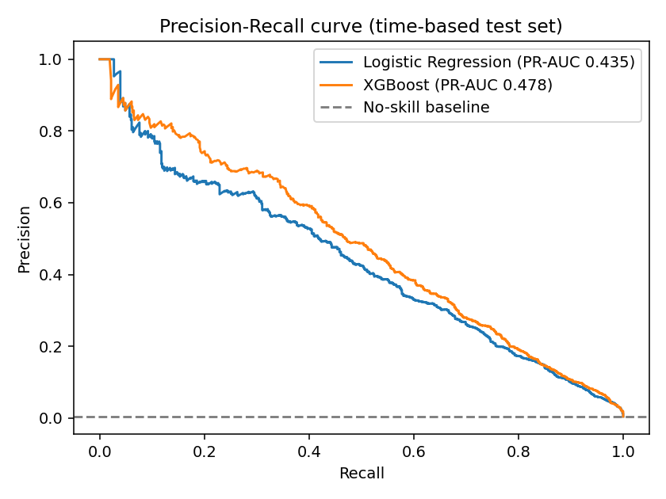

# 🛡️ Transaction Fraud Risk Monitoring

End-to-end fraud analytics project: **SQL analysis → feature engineering → imbalanced-class ML → risk scorecard → interactive dashboard → stakeholder memo.**



## Business problem
A payments business loses money to fraud in TRANSFER and CASH_OUT channels. The existing control is a static rule (*TRANSFER > 200K*) that catches under 10% of fraud. Analysts can only review a small share of traffic, so the goal is to **rank transactions by risk and maximise fraud caught inside a fixed alert budget (top 1%)**.

## Results (600K transactions, time-based hold-out: train on first 70% of time, test on the last 30%)

| Model | PR-AUC | Recall @ 50% precision | Fraud caught in top 1% of scores |
|---|---|---|---|
| Legacy rule (TRANSFER > 200K) | n/a | 10% recall at 17% precision | n/a |
| Logistic Regression (class-weighted) | 0.435 | 42% | 68% |
| **XGBoost** | **0.478** | **47%** | **69%** |

The Critical+High risk tiers (top 1%) cover **88% of fraudulent value**. Full write-up: [`reports/stakeholder_memo.md`](reports/stakeholder_memo.md) (auto-generated from the pipeline outputs).

> ⚠️ **Data note:** results above are on a *synthetic* PaySim-style dataset generated by `src/generate_data.py` (so the repo runs with no downloads). To use the real [PaySim dataset from Kaggle](https://www.kaggle.com/datasets/ealaxi/paysim1), save it as `data/transactions.csv` and skip the `data` step. Column names are identical. Numbers will change; re-run and update this table.

## Key findings (SQL + EDA)
- 100% of fraud sits in `CASH_OUT` and `TRANSFER`.
- Fraud rate climbs steeply with amount (≈0.01% under 10K → ≈35% above 1M).
- Fraud rate is ~9× higher when the origin account is drained (2.47% vs 0.27%).
- Hours 00–05 hold 25% of volume but 59% of fraud.

## Architecture
```
generate_data.py ─► data/transactions.csv ─► load_db.py ─► SQLite (data/fraud.db)
                                                              │
                              sql/analysis.sql ◄──────────────┤ run_sql_analysis.py ─► reports/sql/*.csv
                                                              ▼
                       features.py ─► train.py (LogReg + XGBoost, time split) ─► reports/metrics.json, figures, scored set
                                                              ▼
                                  make_memo.py ─► stakeholder_memo.md      dashboard/app.py (Streamlit)
```

## Quick start
```bash
git clone https://github.com/Adityashukla1019/fraud-risk-monitoring && cd fraud-risk-monitoring
python -m venv .venv && source .venv/bin/activate      # Windows: .venv\Scripts\activate
pip install -r requirements.txt
make all            # data -> db -> sql -> train -> memo   (~1 min)
make dashboard      # opens http://localhost:8501
make test
```
No `make` (Windows)? Run: `python -m src.generate_data && python -m src.load_db && python -m src.run_sql_analysis && python -m src.train && python -m src.make_memo && streamlit run dashboard/app.py`

## Dashboard
Four tabs: **Trends & Drivers** (daily trend with 7-day rolling average, hour, type, amount band, drained-account root cause, mule-account candidates), **Risk Scorecard** (Critical/High/Medium/Low tiers with observed fraud rates), **Flagged Transactions** (filterable, CSV download), **Model Performance**.

## Design decisions (interview talking points)
- **Time-based split**, not random: production scores future transactions, so random splits leak.
- **No accuracy:** at 0.4% fraud, "never fraud" is 99.6% accurate. Used PR-AUC, recall at fixed precision, and top-1% capture.
- **Imbalance:** `class_weight="balanced"` for LR, `scale_pos_weight` for XGBoost. No SMOTE: synthetic oversampling distorts probability calibration, and weights worked fine.
- **Alert-budget tiers** mirror how fraud operations are staffed.
- **Leakage control:** `isFlaggedFraud` (output of a legacy rule) and account IDs are excluded from features.
- **SQL skills shown:** CTEs, window functions (rolling average, `RANK`), conditional aggregation, banding with `CASE`.
- **Accounting-identity features** (`err_orig`, `err_dest`) catch balance inconsistencies.

## Limitations
Synthetic data; confirmed-fraud labels only; no customer-level history features (velocity, device); model would need drift monitoring and recalibration in production.

## Project structure
```
sql/            schema.sql, analysis.sql (7 named queries)
src/            generate_data, load_db, run_sql_analysis, features, train, make_memo
dashboard/      Streamlit app
tests/          pytest suite (7 tests)
reports/        memo, metrics.json, figures, SQL outputs
.github/        CI: tests + smoke-run of full pipeline
```

## PostgreSQL / Power BI
`sql/schema.sql` is PostgreSQL-compatible with minor type changes. To use Power BI, load `reports/scored_test_set.csv` and `reports/sql/*.csv`.

## License
MIT
